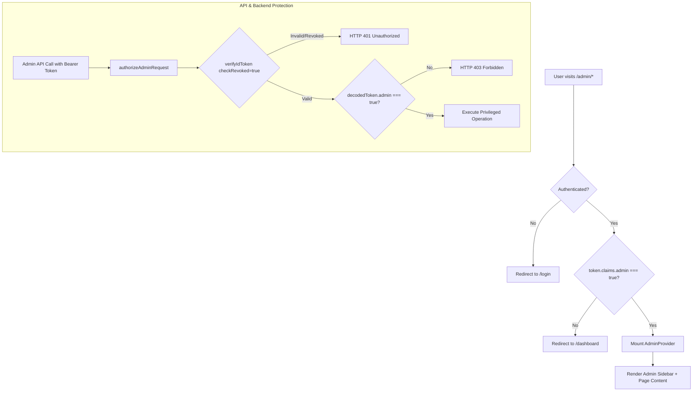
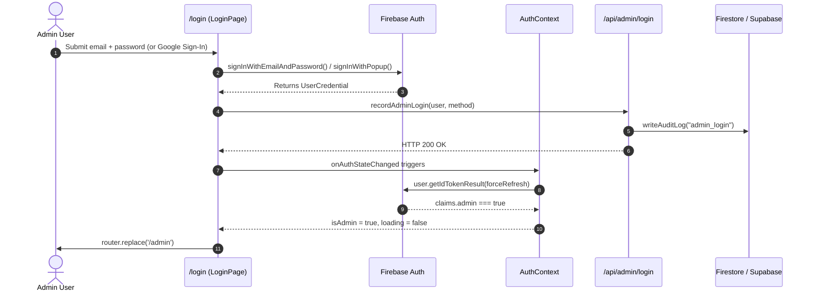
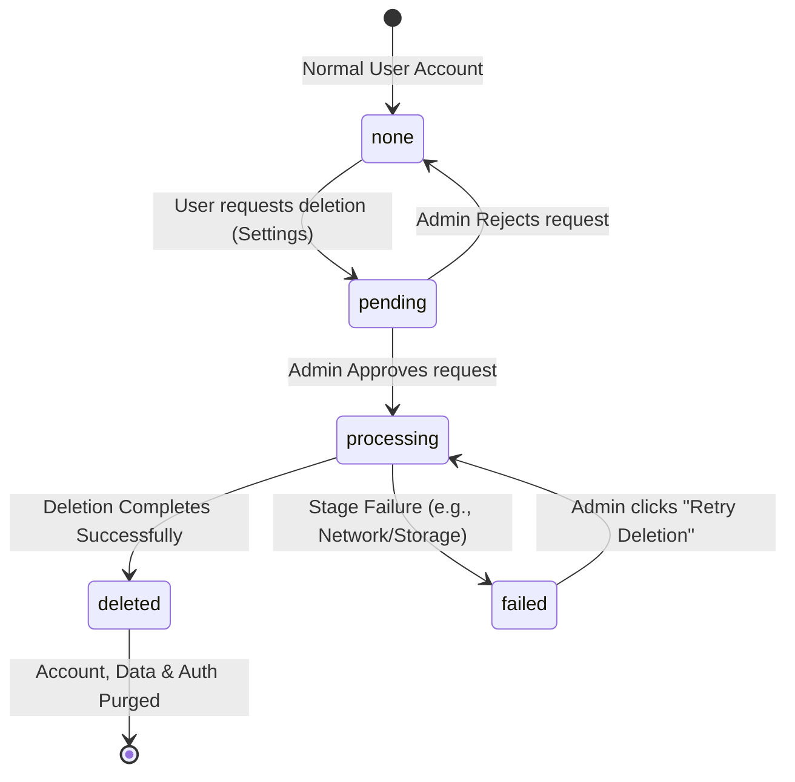

# LitterSense Admin Dashboard — Comprehensive Technical Documentation & Architecture Flow

This document provides an end-to-end technical analysis and workflow documentation for the **LitterSense Admin Dashboard** (`/admin`). It details the security model, authentication lifecycle, UI/UX architecture, state management, API endpoints, database interactions, and the account deletion workflow.

---

## 1. Executive Summary & Purpose

The **LitterSense Admin Panel** is a restricted, server-audited administrative interface designed for platform maintainers. Its core responsibilities include:
1. **System Health & Aggregates**: Monitoring total users, cat counts, gender distributions, and top cat owners.
2. **Account Deletion Management**: Managing a real-time queue of owner-submitted account deletion requests with resilient, multi-stage permanent deletion, atomic rejection, and idempotent retry capabilities.
3. **Audit Log Inspection**: Providing a real-time, tamper-proof audit trail of administrative activities (sign-ins, privilege changes, deletion lifecycle events).
4. **User Inspection**: Searching and reviewing registered users and their registered cats.
5. **Secure Privilege Administration**: Enforcing server-side CLI management for administrative credentials via Firebase Custom Claims (no browser-side privilege escalation).

---

## 2. Security & Access Control Architecture

The Admin Dashboard enforces a **defense-in-depth** security model across client routing, Firebase Custom Claims, Firestore security rules, and server-side API authorization.



### 2.1 Firebase Custom Claims (No Database Allowlists)
- Admin privileges are strictly derived from the Firebase Auth token claim: `tokenResult.claims.admin === true`.
- Legacy email hardcoding and client-writable document allowlists (`/admins/*`) have been retired.
- Privilege changes are executed via a server-only CLI utility (`scripts/manage-admin.mjs`):
  ```bash
  npm run admin:grant -- admin@example.com
  npm run admin:revoke -- admin@example.com
  ```
- Revoking an admin automatically revokes their Firebase refresh tokens.

### 2.2 Client-Side Access Boundary (`AdminRoute`)
- Located at `components/AdminRoute.tsx`.
- Intercepts requests before the admin context initializes:
  - If `loading` is true: Renders a neutral, branded spinner.
  - If unauthenticated: Replaces URL with `/login`.
  - If authenticated but not an admin: Replaces URL with `/dashboard`.
- **Neutral Exposure Rule**: Regular user navigation (`components/layout/TopBar.tsx` and `components/layout/BottomNav.tsx`) completely omits any `/admin` links.

### 2.3 Firestore Security Rules Isolation
In `firestore.rules`:
- `isAdmin()` helper: `request.auth != null && request.auth.token.admin == true`.
- `auditLogs`: Read-only for admins; write is completely blocked for all client sessions (`allow write: if false;`).
- `users`: Admins can read all documents and subcollections for aggregate reporting; deletion is handled exclusively by server routes (`allow delete: if false;`).

---

## 3. End-to-End Authentication & Login Flow



1. **Unified Login Portal**: Admins log in through the standard `/login` interface—there is no separate hidden credential form.
2. **Audit Logging**: Upon successful login, `recordAdminLogin()` fires a `POST` to `/api/admin/login` passing the sign-in method (`password` or `google`). The server verifies the token and writes an `admin_login` audit entry.
3. **Role-Aware Redirection**: `LoginPage` detects `isAdmin === true` and routes the administrator to `/admin` instead of the owner `/dashboard`.

---

## 4. Admin Layout & Component Hierarchy

The layout structure is defined in `app/admin/layout.tsx`:

```text
AdminLayout (app/admin/layout.tsx)
 ├── AdminRoute (Gate: checks auth & isAdmin)
 │    └── AdminProvider (lib/contexts/AdminContext.tsx)
 │         └── <div className="flex flex-col lg:flex-row min-h-screen">
 │              ├── AdminSidebar (components/layout/AdminSidebar.tsx)
 │              │    ├── BrandHeader ("LitterSense Admin Panel")
 │              │    ├── NavLinks:
 │              │    │    ├── /admin (Overview)
 │              │    │    ├── /admin/users (Users)
 │              │    │    ├── /admin/requests (Delete Requests + Badge)
 │              │    │    └── /admin/add-admin (Admin Access)
 │              │    ├── Admin Profile Card (Initial, Name, Email, "Admin" badge)
 │              │    └── Sign out Button (unregisters FCM, signs out)
 │              └── {children} (Page Route)
```

### Context Providers Involved:
- **`AdminProvider`** (`lib/contexts/AdminContext.tsx`):
  - Loads all users from Firestore `users` collection along with their `cats` and `catDetails` subcollections.
  - Subscribes in real-time to the latest 50 entries in `auditLogs` ordered by `createdAt desc`.
  - Manages toast notification state and client-side user suspension toggles.
- **`DeleteRequestProvider`** (`lib/contexts/DeleteRequestContext.tsx`):
  - Mounted globally in `app/layout.tsx`.
  - Subscribes in real-time to `users` where `deletionStatus in ['pending', 'processing', 'failed']`.
  - Powers the sidebar badge counter and the pending deletions count on the overview page.

---

## 5. Detailed Page Breakdown

### 5.1 Overview Page (`/admin`)
- **File**: `app/admin/page.tsx`
- **Key Functions & Subcomponents**:
  - **KPI Stat Cards**:
    - `Total Users`: Count of all registered users.
    - `Total Cats`: Sum of all registered cats across all users.
    - `Pending Deletions`: Count of pending deletion requests (triggers "abnormal / Needs review" badge if > 0).
    - `Active Users`: Users with active status.
  - **Visualizations (Recharts)**:
    - **Cat Gender Split**: Donut pie chart displaying Male vs. Female cats with exact counts.
    - **Cats per User**: Horizontal bar chart displaying the top 10 cat owners.
  - **Quick Action Links**: Cards pointing directly to `/admin/users` and `/admin/requests`.
  - **Recent Audit Activity Feed** (`components/admin/AuditLogList.tsx`):
    - Real-time stream of the latest 50 administrative actions.
    - Displays action title, actor UID/email, target UID/email, specific details, and relative/formatted timestamp.

### 5.2 Users Management Page (`/admin/users`)
- **File**: `app/admin/users/page.tsx`
- **Key Functions**:
  - **Live Search**: Instant client-side search across user names and email addresses.
  - **Column Sorting**: Sortable by Name, Registered Date, and Cat Count (ascending & descending).
  - **Responsive Design**:
    - Desktop: Structured tabular view with user initials, registration date, cat count, and status badges.
    - Mobile: Card-based layout with compact statistics.
  - **User Actions**:
    - `View User`: View user details.
    - `Suspend / Restore`: Toggle user status between active and inactive.

### 5.3 Account Deletion Queue Page (`/admin/requests`)
- **File**: `app/admin/requests/page.tsx`
- **Component**: `components/admin/DeletionQueue.tsx`
- **State Display**:
  - `Pending`: Account deletion requested; shows **Approve** and **Reject** buttons.
  - `Processing`: Deletion currently underway; shows progress indicator and a "Retry cleanup" fallback if interrupted for > 10 minutes.
  - `Deletion failed`: Shows the specific failure message from the backend and a **Retry deletion** button.

---

## 6. The Account Deletion Lifecycle

Account deletion is an asynchronous, multi-stage workflow designed to prevent orphan data, support retries on partial failures, and retain permanent audit records.



### 6.1 Step-by-Step Approval & Cleanup Sequence
When an admin clicks **Approve** (and confirms the modal) in `/admin/requests`, the client invokes `POST /api/admin/delete-user`:

1. **Authorization & Token Revocation Check**:
   - `authorizeAdminRequest()` verifies the admin Bearer token and validates that the caller has not been revoked.
2. **Atomic Request Claiming**:
   - Updates target user document: `deletionStatus = 'processing'`, `deletionStartedAt = now()`.
   - Prevents race conditions from multiple admins acting on the same request.
3. **Session Revocation**:
   - `getAdminAuth().revokeRefreshTokens(userId)` invalidates existing user sessions.
4. **Data Purging (In Strict Hierarchical Order)**:
   - **Supabase/SMS Backup Data**: Calls `deleteOwnerMedia(userId)` and deletes records from `sms_accounts`.
   - **Recursive Firestore Subcollections**: Iterates through all subcollections under `users/{userId}` (including `cats`, `sessions`, `anomalies`, `reports`, `notifications`, `catDetails`) and recursively deletes all documents.
   - **Linked Top-Level Documents**: Recursively deletes documents in `deviceConfigs`, `cameraDevices`, and legacy `deleteRequests` where `ownerId === userId`.
   - **Predictive Health Limits**: Deletes `predictiveHealthLimits/{userId}`.
   - **Firebase Storage Assets**: Deletes all storage objects under the prefix `users/{userId}/` (cat photos, profile pictures).
   - **USER Firestore Document**: Deletes `users/{userId}`.
   - **Firebase Auth Account**: Permanently deletes the user via `getAdminAuth().deleteUser(userId)`.
5. **Success Audit Logging**:
   - Writes immutable `deletion_approved` audit log. Target UID and target email are intentionally retained in the audit log for compliance.
6. **Error Handling & Idempotent Retry**:
   - If any step fails, the user document is retained/recreated with `deletionStatus = 'failed'` and a descriptive `deletionError`.
   - An audit log of type `deletion_failed` is generated.
   - The admin can resolve the external issue (e.g. storage quota) and click **Retry deletion**; the endpoint safely proceeds past already-deleted items.

### 6.2 Rejection Sequence
When an admin clicks **Reject**:
1. Invokes `POST /api/admin/deletion-request/reject`.
2. Validates admin authorization.
3. Atomically updates the user document:
   - `deletionStatus = 'none'`
   - Deletes `deletionRequestedAt` and `deletionError`.
4. Writes `deletion_rejected` audit entry.
5. The owner account remains active, and their data remains completely intact.

---

## 7. Administrative Privilege Management (`/admin/add-admin`)

- **File**: `app/admin/add-admin/page.tsx`
- **Component**: `components/admin/ServerManagedAdminAccess.tsx`
- **Principle**: **Browser controls cannot grant or revoke administrator access.**
- **Workflow**:
  1. The target user creates a standard account via the signup flow.
  2. A developer or system owner opens a secure terminal in the project directory with server credentials (`FIREBASE_SERVICE_ACCOUNT_BASE64`).
  3. Run the CLI script:
     ```bash
     # Grant admin privileges
     npm run admin:grant -- target_email@example.com

     # Revoke admin privileges
     npm run admin:revoke -- target_email@example.com
     ```
  4. The script updates the user's Firebase custom claims (`admin: true`), records an audit entry (`admin_granted` or `admin_revoked`), and (on revoke) invalidates their refresh tokens.
  5. The target user signs out and back in to refresh their ID token.

---

## 8. Summary of Admin API Routes & Utilities

| Endpoint / File | Method | Description | Auth Required |
|---|---|---|---|
| `/api/admin/login` | `POST` | Records interactive administrator login in audit logs. | Admin Bearer Token |
| `/api/admin/delete-user` | `POST` | Executes multi-stage permanent deletion of user and data. | Admin Bearer Token |
| `/api/admin/deletion-request/reject` | `POST` | Rejects pending deletion request and restores account status. | Admin Bearer Token |
| `/api/admin/update-password` | `POST` | Resets a specified user's password via Admin Auth. | Admin Bearer Token |
| `lib/server/adminAuth.ts` | Code | Verifies Bearer ID token with revocation check and validates `admin === true`. | Server utility |
| `lib/server/auditLog.ts` | Code | Writes immutable audit log entries to Firestore / Supabase. | Server utility |
| `lib/utils/adminApi.ts` | Code | Authenticated fetch wrapper handling token injection and 401/403 redirects. | Client utility |
| `scripts/manage-admin.mjs` | CLI | Script to grant/revoke admin claims using Firebase Admin SDK. | Local CLI |

---

## 9. Key Audit Actions Logged

| Action Key | Triggered By | Details Stored |
|---|---|---|
| `admin_login` | Interactive admin login via `/login` | `signInMethod` (`password` or `google`) |
| `admin_granted` | `npm run admin:grant` | Source: `manage-admin-script` |
| `admin_revoked` | `npm run admin:revoke` | Source: `manage-admin-script` |
| `deletion_requested` | User clicks Delete Account in Settings | User-selected deletion reason |
| `deletion_approved` | Admin approves deletion in `/admin/requests` | Result: `permanently_deleted` |
| `deletion_rejected` | Admin rejects deletion in `/admin/requests` | Result: `returned_to_normal` |
| `deletion_failed` | Failure during deletion stages | Cleanup stage and error message |

## Dedicated Administrator Login

Administrators may sign in at `/admin/littersense-1cbada72815d574ac7beddfe`. This page lives in
`app/(auth)/admin/littersense-1cbada72815d574ac7beddfe/page.tsx`, outside the protected admin layout,
so signed-out visitors can reach the login form. The normal `/login` remains available.

The dedicated page reuses the existing login form with administrator branding and
no signup prompt. Email/password and Google sign-in both force-refresh and verify
the boolean `admin: true` custom claim before auditing and completing login.
Non-admin and unverifiable sessions are signed out. The dedicated Google flow does
not create or overwrite owner profile records. Existing admin route and server API
authorization remain mandatory; the URL is not a password or an access credential.
The page requests `noindex, nofollow` in its metadata. Deployment is required before
the new route becomes available on the hosted application.
