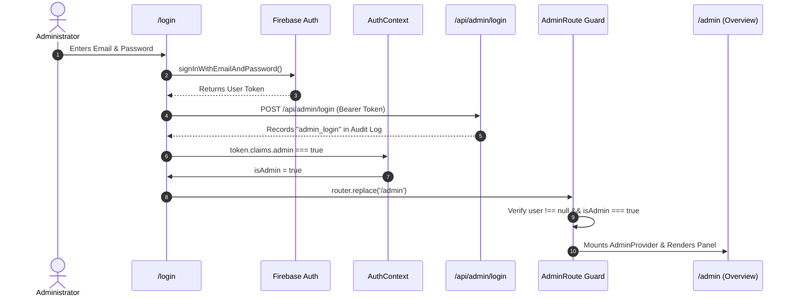
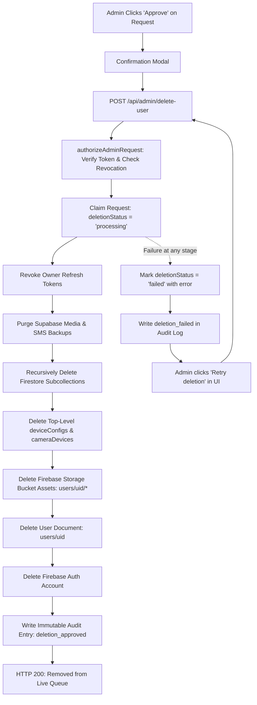

# Admin Documentation

## LitterSense IoT Monitoring Platform

---

## 1. Executive Summary

The **LitterSense Admin Dashboard** (`/admin`) is a restricted, server-audited administrative control center designed for platform maintainers. It serves three core operational purposes:
1. **System Health & Aggregates**: Provides macro-level statistics on registered user accounts, cat demographics, gender splits, and top cat owners.
2. **Account Deletion Queue**: Manages owner-submitted GDPR/compliance account deletion requests with an atomic, multi-stage permanent cleanup process, failure retention, and retry capabilities.
3. **Immutable Audit Logging**: Offers a tamper-resistant real-time audit feed tracking all administrative logins, privilege grants/revocations, and account deletion lifecycle events.

---

## 2. Data Storage & System Topology

The platform utilizes a **hybrid dual-database architecture** integrating **Firebase Authentication**, **Supabase PostgreSQL**, and **Google Cloud Firestore**.

```
                           ┌──────────────────────────────┐
                           │    Firebase Authentication   │
                           │   • Passwords & Credentials  │
                           │   • JWT ID Token             │
                           │   • Custom Claim (admin: true│
                           └──────────────┬───────────────┘
                                          │
                                          ▼
                           ┌──────────────────────────────┐
                           │ Next.js App Router (/admin)  │
                           │ • AdminRoute Guard           │
                           │ • Server APIs (/api/admin/*) │
                           └──────────────┬───────────────┘
                                          │
            ┌─────────────────────────────┴─────────────────────────────┐
            │ SUPABASE_RFID_PRIMARY_ENABLED = true                     │ Default / Fallback
            ▼                                                           ▼
┌───────────────────────────────────────┐             ┌───────────────────────────────────┐
│               SUPABASE                │             │             FIRESTORE             │
│ • User Profiles (operational_records) │             │ • User Documents (users/{uid})    │
│ • Audit Log (operational_write_audit) │             │ • Audit Log (auditLogs/{id})      │
│ • Deletion RPCs (admin_transition)    │             │ • Device Configs (deviceConfigs)  │
│ • Media Storage (Cat/Profile Photos)  │             │ • Storage Bucket (users/{uid}/)   │
│ • SMS Account Backups (sms_accounts)  │             └───────────────────────────────────┘
└───────────────────────────────────────┘
```

### Where is Admin Data Stored?

| Data Element | Storage Location | Explanation |
|---|---|---|
| **Admin Login & Password** | **Firebase Authentication** | Credentials, hashing algorithms, and email tokens are maintained strictly within Firebase Auth. |
| **Admin Role & Authority** | **Firebase Custom Claims** | Admin rights are **not** stored as an editable database field. They exist as a signed cryptographic custom claim (`token.claims.admin = true`) on the user's ID token. |
| **Admin Profile Document** | **Supabase** (`operational_records` table) | The administrator’s display name, phone number, and settings are stored under `document_path = 'users/{adminUid}'`. |
| **Admin Audit History** | **Supabase** (`operational_write_audit`) | All admin logins, privilege grants/revocations, and account deletion decisions are logged via Supabase RPCs. |

---

## 3. Data Visibility: What the Admin Can and Cannot See

### What the Admin CAN See:
Through role-based access verified in `lib/server/operationalRecords.ts`, an administrator with `claims.admin === true` is granted `@all` read access across user records:
1. **Registered Users Directory**:
   - Full names, email addresses, and registration dates.
   - Account status (`active` or `inactive`).
   - Total number of registered cats per user.
2. **Cat Aggregates & Demographics**:
   - Cat names and genders across all users (powers the Gender Split chart).
   - Top 10 cat owners ranked by cat count.
3. **Account Deletion Requests**:
   - User identities of those requesting permanent account deletion.
   - Request timestamps, reason selected, and any failure error messages.
4. **Recent System Audit Logs**:
   - Chronological list of the last 50 server-recorded administrative actions.

### What the Admin CANNOT See (Privacy & Security Isolation):
- **User Passwords**: Passwords are encrypted and salted in Firebase Auth and are never visible to anyone (including administrators).
- **Private Sensor Graphs & Telemetry**: The Admin Dashboard is purely an account management portal. It does **not** display individual users' live sensor telemetry, ambient ammonia/H₂S readings, or litter box visit graphs.
- **Camera Feeds & Live Streams**: The Admin Dashboard contains no video relay access. Cat owners' camera streams remain strictly isolated to the owner.
- **Veterinary Notes & Private Cat Histories**: The admin view reads only cat counts and genders for macro statistics.

---

## 4. Admin Privilege Management (Server-Only Security)

Browser UI controls **cannot** elevate privileges. Admin status must be granted or revoked from a secure terminal with server credentials configured (`FIREBASE_SERVICE_ACCOUNT_BASE64`).

```bash
# Grant Admin Privileges
npm run admin:grant -- target_email@example.com

# Revoke Admin Privileges (also revokes active refresh tokens)
npm run admin:revoke -- target_email@example.com
```

### Technical Workflow:
1. The script (`scripts/manage-admin.mjs`) calls `getAuth().setCustomUserClaims(user.uid, { admin: true })`.
2. When revoked, the script deletes the `admin` key and immediately invokes `getAuth().revokeRefreshTokens(user.uid)`.
3. An immutable audit record (`admin_granted` or `admin_revoked`) is written to Supabase / Firestore.
4. The user must sign out and sign back in (or refresh their ID token) for claim changes to take effect.

---

## 5. Authentication & Access Guard Flow



### The Neutral Access Boundary (`AdminRoute`)
- Defined in `components/AdminRoute.tsx`.
- Wraps all routes within `app/admin/layout.tsx`.
- If an unauthenticated user visits `/admin`, they are redirected to `/login`.
- If a regular cat owner visits `/admin`, they are redirected to `/dashboard`.
- Owner navigation components (`TopBar`, `BottomNav`) contain zero links to `/admin`.

---

## 6. Page-by-Page Feature Reference

### 6.1 Dashboard Overview (`/admin`)
* **Route**: `app/admin/page.tsx`
* **Features**:
  * **Summary KPI Cards**:
    * **Total Users**: System-wide user count.
    * **Total Cats**: Cumulative registered cats across all households.
    * **Pending Deletions**: Active deletion requests in queue. Changes to `Needs review` (red badge) when > 0.
    * **Active Users**: Active accounts count.
  * **Interactive Visualizations (Recharts)**:
    * **Cat Gender Split**: Donut pie chart displaying Male vs. Female distribution.
    * **Cats per User**: Horizontal bar chart identifying the top 10 cat owners.
  * **Audit Log Stream** (`components/admin/AuditLogList.tsx`):
    * Displays the latest 50 administrative events (actor email, action, target email, timestamp, and metadata).

---

### 6.2 Users Directory (`/admin/users`)
* **Route**: `app/admin/users/page.tsx`
* **Features**:
  * **Instant Filter**: Search bar filtering across user names and email addresses.
  * **Sorting Controls**: Sortable by Name, Registered Date, and Cat Count (ascending/descending).
  * **Dual Responsive Layout**: Tabular view for desktop screens and compact cards for mobile devices.
  * **Account Controls**: Visual status badge (`active` / `inactive`) and Suspend/Restore toggle.

---

### 6.3 Account Deletion Queue (`/admin/requests`)
* **Route**: `app/admin/requests/page.tsx`
* **Component**: `components/admin/DeletionQueue.tsx`
* **Features**:
  * Subscribes to real-time status updates where `deletionStatus IN ['pending', 'processing', 'failed']`.
  * **Status Indicators**:
    * `Pending`: New request awaiting admin action.
    * `Deletion in progress`: Multi-stage purge currently running on the server.
    * `Deletion failed`: Shows the exact failure stage with a **Retry deletion** button.

---

### 6.4 Admin Access Guide (`/admin/add-admin`)
* **Route**: `app/admin/add-admin/page.tsx`
* **Component**: `components/admin/ServerManagedAdminAccess.tsx`
* **Features**:
  * Outlines the platform security policy.
  * Displays terminal commands for granting or revoking administrative claims via the local CLI tool.

---

## 7. Account Deletion Lifecycle & Multi-Stage Cleanup

The account deletion workflow complies with data privacy requirements and includes built-in retry mechanisms to prevent orphaned records:



### Stage-by-Stage Cleanup Order:
1. **Request Locking**: Marks `deletionStatus = 'processing'` with timestamp to prevent concurrent execution.
2. **Session Invalidation**: Revokes the user's refresh tokens via `getAdminAuth().revokeRefreshTokens(userId)`.
3. **Supabase Media & SMS**: Deletes records in `sms_accounts` and owner profile images in Supabase Storage.
4. **Subcollection Recursion**: Recursively iterates through `cats`, `sessions`, `anomalies`, `reports`, `notifications`, and `catDetails` to wipe all documents.
5. **Hardware Records**: Deletes linked provisioning documents in `deviceConfigs` and `cameraDevices`.
6. **Storage Assets**: Wipes all photos under the bucket prefix `users/{userId}/`.
7. **Document & Auth Purge**: Deletes `users/{userId}` and calls `getAdminAuth().deleteUser(userId)`.
8. **Compliance Audit**: Writes `deletion_approved` preserving actor and target identity for auditing.

### Rejection Sequence:
When an admin clicks **Reject**:
- Calls `POST /api/admin/deletion-request/reject`.
- Atomically resets `deletionStatus` back to `'none'`.
- Deletes `deletionRequestedAt` and `deletionError`.
- Writes a `deletion_rejected` audit entry.
- The user account remains fully active with zero loss of cat or visit data.

---

## 8. Server API Reference

| Endpoint | Method | Required Authorization | Function |
|---|---|---|---|
| `/api/admin/login` | `POST` | Bearer Token (`admin: true`) | Logs interactive admin sign-ins in the audit log. |
| `/api/admin/delete-user` | `POST` | Bearer Token (`admin: true`) | Executes ordered multi-stage permanent deletion of user, auth, and data. |
| `/api/admin/deletion-request/reject` | `POST` | Bearer Token (`admin: true`) | Rejects a pending deletion request and restores account status to normal. |
| `/api/admin/update-password` | `POST` | Bearer Token (`admin: true`) | Administrative reset for a user password via Firebase Admin SDK. |

---

## 9. Audit Event Glossary

| Action Event | Trigger Source | Details Recorded |
|---|---|---|
| `admin_login` | Admin signs in via `/login` | `signInMethod`: `"password"` or `"google"` |
| `admin_granted` | `npm run admin:grant` | Target email, UID, source: `"manage-admin-script"` |
| `admin_revoked` | `npm run admin:revoke` | Target email, UID, source: `"manage-admin-script"` |
| `deletion_requested` | User requests deletion in Settings | Selected user reason |
| `deletion_approved` | Admin approves deletion in `/admin/requests` | Result: `"permanently_deleted"` |
| `deletion_rejected` | Admin rejects deletion in `/admin/requests` | Result: `"returned_to_normal"` |
| `deletion_failed` | Deletion fails at any cleanup stage | Specific cleanup stage and error details |
